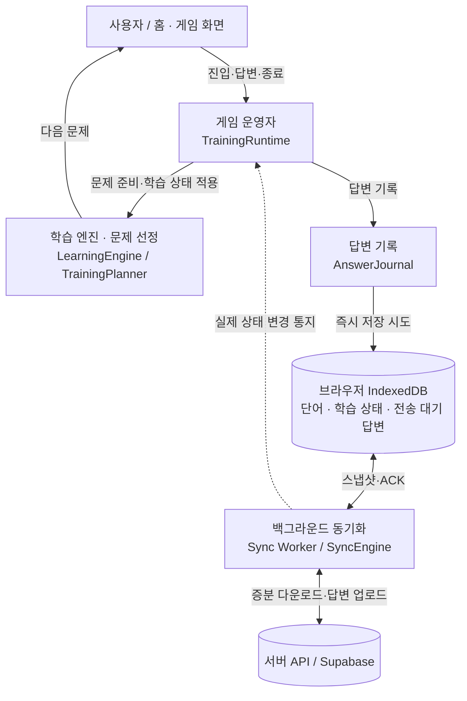

# Sokudoku 아키텍처

> **한 문장 요약:** 게임은 로컬 데이터로 즉시 진행하고, 서버 동기화는 별도로 움직인다. 답변은 먼저 로컬에 기록하며, 실제로 데이터가 바뀔 때만 다음 문제 선정에 반영한다.

이 문서는 코드를 처음 보는 사람을 위한 **책임 지도**다. 호출 순서나 장애 대처를 알고 싶으면 [게임 생명주기](./GAME_LIFECYCLE.md)와 [동기화·복구](./SYNC_AND_RECOVERY.md)를 본다. 절대 깨지면 안 되는 규칙은 [불변조건](./INVARIANTS.md)에 모았다.

## 1. 전체 구조

**그림 읽는 법:** 위아래 배치가 실행 순서를 뜻하지는 않는다. 게임과 Worker는 병렬로 동작한다. Phaser는 화면·입력·타이머·피드백을 맡고, FSRS나 서버 요청을 직접 결정하지 않는다.

## 2. 다섯 가지 책임

| 영역 | 한 가지 책임 | 하지 않는 일 |
| --- | --- | --- |
| 화면 (React + Phaser) | 문제 표시, 입력, 결과·연출 | 서버에 매 문제 직접 조회하지 않음 |
| 학습·출제 | FSRS 갱신, 복습·탐색 우선순위, 4지선다 구성 | 답변을 서버에 저장하지 않음 |
| 런타임 | 게임 시작·종료와 구성요소 연결, 갱신 시점 결정 | 화면을 직접 그리지 않음 |
| 로컬 저장소 | 단어 캐시, 학습 스냅샷, 전송 대기 답변 보관 | 서버 업로드 성공을 보장하지 않음 |
| 동기화 Worker | 변경분 수신, 답변 업로드, 로컬 원자적 반영 | 화면에 표시 중인 문제를 직접 교체하지 않음 |

## 3. 데이터는 어디에 있는가?

| 데이터 | 사용 중 기준 | 지속성 |
| --- | --- | --- |
| 출제 가능한 단어·선택지 | 로컬 동기화 스냅샷에서 구성한 카탈로그 | IndexedDB에 캐시, 서버가 원본 |
| 현재 FSRS 카드·실력 | 게임 내 학습 엔진 (답변 즉시 반영) | 서버 상태 + 로컬 미전송 답변으로 재구성 |
| 현재 5문제 묶음 | 게임 메모리의 문제 큐 | 일시적. 재진입 시 새로 구성 가능 |
| 사용자가 방금 푼 답변 | IndexedDB 전송 대기 큐 (UUID) | 로컬 쓰기가 완료되면 서버 장애 중에도 재시도 가능 |
| 확정된 서버 답변 | Supabase 답변 로그 | 서버가 원본. 파생 FSRS 반영은 뒤따를 수 있음 |

**중요한 구별:** 화면의 “저장 완료”는 **로컬 저장 완료**를 뜻한다. 서버 업로드 완료와 동일하지 않다. 브라우저 저장소가 삭제되면 아직 업로드하지 못한 답변은 복구할 수 없다.

## 4. 데이터가 변할 때의 정책

| 사건 | 현재 화면 | 미출제 문제 큐 |
| --- | --- | --- |
| 보통의 답변 | 정답·오답 피드백 | 그대로 사용, 답변은 학습 엔진에 즉시 반영 |
| 이미 반영한 답변의 서버 ACK | 그대로 | **유지** (동일한 FSRS 상태라면) |
| 다른 기기 등의 실제 학습 상태 변경 | 그대로 | 다음 전환에서 다시 선정 |
| 단어·선택지 변경 | 그대로 | 다음 전환에서 새 카탈로그로 선정 |
| 오프라인·서버 오류 | 계속 진행 가능하면 유지 | 로컬 데이터로 진행 |

새 데이터가 왔다는 사실과 **출제에 영향을 주는 상태가 실제로 달라졌다는 사실**을 혼동하지 않는다.

## 5. 코드를 찾는 최소한의 지도

**파일을 처음부터 끝까지 순서대로 읽을 필요는 없다.** 궁금한 행동의 진입점 하나만 열면 된다.

| 궁금한 것 | 시작할 곳 |
| --- | --- |
| 홈에서 게임 첫 문제를 미리 준비하는 과정 | `lib/game/data/home-preloader.ts` |
| 게임 전체 생명주기·동기화 통지 | `lib/game/data/training-runtime.ts` |
| 5문제 묶음과 FSRS | `lib/game/learning/planner.ts` |
| Phaser 문제 전환·답변 | `lib/game/phaser/training-run.ts` |
| 답변의 로컬 내구성 | `lib/game/data/answer-journal.ts` |
| 서버와의 증분 동기화 | `lib/sync/engine.ts` |

세부 구현 파일은 IDE의 정의로 이동해서 찾는다. **문서에는 모든 import나 모든 분기를 복제하지 않는다.**

## 6. 문서를 유지하는 원칙

- 새 예외 상황이 생기면 거대한 흐름도를 키우지 말고 해당 **시나리오 또는 정책표 한 행**을 보강한다.
- 코드 경로가 바뀌면 위 **진입점 표만** 갱신한다.
- 설계 의사결정이 바뀌면 먼저 [불변조건](./INVARIANTS.md)을 확인한다.
