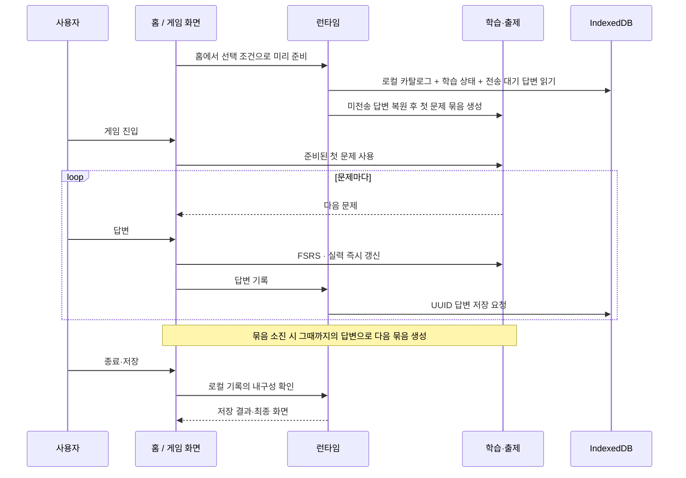

# 게임 생명주기

> 질문: “언제 문제가 만들어지고, 언제 답변이 반영되며, 어디에서 게임이 멈출 수 있나?”

이 문서는 **플레이어가 보는 한 판**을 따라간다. 저장·서버 장애의 상세 절차는 [동기화·복구](./SYNC_AND_RECOVERY.md), 역할 구분은 [아키텍처](./ARCHITECTURE.md) 참고.

## 1. 정상 경로

## 2. 각 단계가 하는 일

**① 홈에서 준비**  
선택된 계정·단계·문제 종류·학습 모드가 일치하면 홈에서 만든 **실제 첫 문제 묶음**을 게임 진입 시 그대로 넘긴다. 선택이 바뀌면 기존 준비물을 폐기한다.

**② 로딩·복원**  
단어 스냅샷과 같은 시점의 미전송 답변을 읽는다. 기존 서버 학습 상태에 아직 반영되지 않은 답변을 재적용한 후 학습 엔진과 문제 생성기를 만든다. Worker가 사용할 수 없으면 유효한 로컬 데이터로 오프라인 진입을 시도한다.

**③ 문제 묶음 생성**  
자동 모드와 시험 모드는 일반적으로 **5문제씩** 준비한다. 탐색과 복습을 함께 선택한 경우에는 각각 최대 5문제씩, 합계 최대 10문제가 섞일 수 있다. 읽기 문제의 선택지 탐색은 필요한 문제에 대해서만 Reading Worker를 이용한다.

**④ 문제 표시·답변**  
Phaser가 문제를 그린 뒤 타이머·입력을 활성화한다. 답변은 중복 입력을 방지하는 게이트를 통과한 뒤 한 번 처리한다. 화면 피드백과 별도로 **학습 엔진의 FSRS·실력은 즉시 갱신**되고, 답변 UUID는 로컬에 저장 요청된다.

**⑤ 다음 문제**  
아직 큐에 문제가 있다면 그 문제를 보여준다. 큐가 비었으면 **직전 문제까지 반영된 상태에서** 다음 묶음을 고른다. 즉, 두 번째 묶음을 첫 번째 묶음 도중 무조건 미리 뽑아 두지 않는다.

**⑥ 종료·재시작**  
게임 중에는 일정 답변 수마다 로컬 저장 확인 및 Worker 동기화 요청을 수행한다. 종료·저장에서는 부분 묶음까지 로컬 저장 완료를 확인하고 결과 화면을 보여준다. 재시도는 새 문제 묶음을 만들되 기존 답변을 무시하지 않는다.

## 3. 사용자 행동과 시스템 결정

| 상황 | 사용자 화면 | 내부에서 하는 일 |
| --- | --- | --- |
| 정답·오답 | 피드백 또는 정답 확인 | FSRS 반영, 답변 저장 요청 |
| 한 묶음의 마지막 답변 | 다음 문제 준비 | 최신 학습 상태로 새 묶음 선정 |
| 읽기 선택지 탐색 중 | 잠깐 준비 상태 | 선택된 문제의 Reading Worker 준비를 기다림 |
| 서버 ACK만 도착 | 현재 문제 그대로 | 동등한 학습 상태면 큐를 유지 |
| 다른 기기 학습이 도착 | 현재 문제 그대로 | 다음 문제 전환 시 새 학습 상태 채택 |
| 단어 목록 수정·삭제 | 현재 문제 그대로 | 다음 전환에서 카탈로그와 큐 갱신 |
| 종료·저장 | 저장 상태 후 결과 | 로컬 쓰기 완료 확인, 서버 업로드는 비동기 |
| 시간 제한 없는 모드 | 타임아웃 없이 진행 | 응답 시간 통계에 해당 값을 넣지 않음 |

## 4. 타이밍에 관한 두 가지 약속

1. **출제 정확성:** 다음 묶음 선정은 이전 묶음의 답변을 반영해야 한다. 전체 단어 후보를 매번 훑는 비용보다 이 규칙을 우선한다.
2. **화면 안정성:** 새 카탈로그가 도착하더라도 **이미 표시된 문제와 선택지는 바뀌지 않는다.** 전환은 다음 문제를 꺼내기 전에 처리한다.

## 5. 장애 상황에서 무엇을 확인할까?

- 게임 첫 진입이 느리다 → 홈 준비가 사용됐는지, 로컬 스냅샷이 있는지, 읽기 인덱스를 준비했는지 확인한다.
- **매 다섯 문제마다** 느리다 → `prepareSet()`에서 후보 선정과 Reading Worker 준비를 나눠 계측한다.
- 답변 뒤 화면이 멈춘다 → Phaser의 입력/피드백 단계와 비동기 문제 준비를 별개로 확인한다.
- 저장 중 나가기가 불안하다 → [동기화·복구](./SYNC_AND_RECOVERY.md)의 로컬 내구성 기준을 확인한다.

이 문서는 파일별 함수 목록이 아니라 **행동별 책임 계약**이다.
