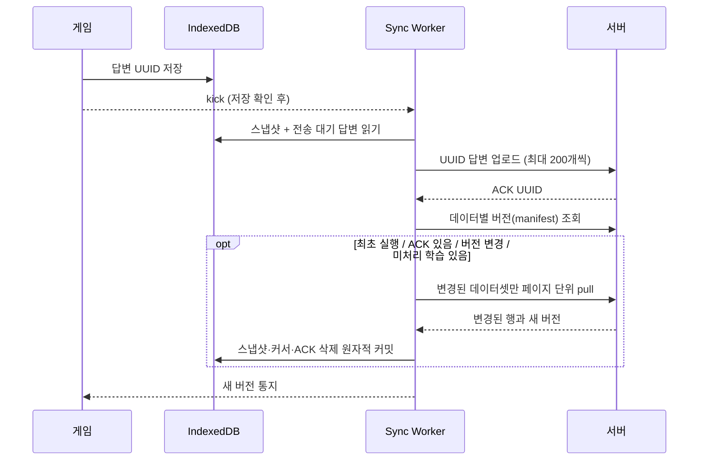

# 동기화와 복구

> **원칙:** 게임은 로컬에서 계속 진행할 수 있어야 한다. 서버 오류 때문에 이미 로컬에 안전하게 기록된 답변을 잃거나, 같은 답변을 두 번 학습시키면 안 된다.

이 문서는 **저장 성공의 뜻**, **Worker가 하는 일**, **실패 후 복구 방법**만 다룬다. 전체 구조는 [아키텍처](./ARCHITECTURE.md), 검사할 규칙은 [불변조건](./INVARIANTS.md).

## 1. 서로 다른 세 가지 상태

| 상태 | 의미 | 다음 행동 |
| --- | --- | --- |
| 게임 메모리에만 있는 답변 | 입력 처리가 끝났지만 IndexedDB 쓰기가 아직 끝나지 않을 수 있음 | 로컬 저장 확인 |
| IndexedDB 전송 대기 큐에 있는 답변 | 로컬에 지속적으로 기록됨, 서버 수신 여부는 불확실 | Worker가 UUID로 업로드·재시도 |
| 서버에 ACK되고 로컬 ACK 커밋까지 된 답변 | 서버 저장 확인과 로컬 큐 정리가 일치함 | 로컬 답변 큐에서 제거 |

**“종료·저장 완료” = 두 번째 상태 이상**이다. 세 번째 상태를 기다리느라 게임 종료를 막지 않는다.

## 2. 정상적인 동기화

Worker는 계정이 설정되면 동기화를 시작하고, 실행 완료 **약 15초 후** 다음 백그라운드 실행을 예약한다. 답변 저장, 온라인 복귀 등의 `kick`은 그 사이 추가 실행을 요청할 수 있다. 일반적인 문제 전환마다 서버를 읽는 구조가 아니다.

변경분을 나누는 일곱 데이터셋은 다음과 같다.

| 분류 | 데이터셋 | 용도 |
| --- | --- | --- |
| 카탈로그 | `words`, `personal_words` | 공통·개인 단어 |
| 선택지 | `distractors`, `extra_choices` | 오답 후보와 추가 선택지 |
| 학습 기록 | `answers` | 서버 답변 이력 |
| 학습 결과 | `learning_states`, `learner` | FSRS 카드·실력 |

버전이 같은 데이터셋은 다시 내려받지 않는다. 카탈로그 버전은 단어·선택지 네 데이터셋으로 구성한다. 답변만 갱신될 때 단어 인덱스를 재구축하지 않도록 구분하는 이유다.

### 서버 저장과 학습 반영은 별도 단계

`/api/game/answers`는 최대 200개의 UUID 답변을 `answer_log`에 중복 무시 방식으로 저장하고 저장된 ID를 확인한 뒤 ACK한다. 삭제된 개인 단어 참조 등 서버가 명시적으로 제외한 답변은 `discarded_ids`로 응답하며, 클라이언트는 이 ID도 큐 정리 대상으로 취급한다. ACK가 모든 답변의 학습 반영 완료를 뜻하지는 않는다.

FSRS 반영은 응답 후 작업으로 시도한다. 남은 작업이 있으면 `/api/sync`의 pull 시작 시에도 보정한다. 서버의 `learning_work`는 미처리 답변과 해당 카드만 읽고, `commit_learning`은 예상 revision을 확인하며 변경 카드·learner·처리 ID를 반영한다. 처음 학습 상태를 만들거나 모델 버전이 바뀌거나 과거 시각의 답변이 늦게 도착하면 전체 이력으로 재구성할 수 있다. 따라서 서버에서도 모든 시나리오가 변경 행만 읽는 경로는 아니다.

Worker는 페이지를 읽은 뒤 manifest의 버전과 미처리 학습 여부를 다시 확인한다. 보정·다운로드·로컬 커밋이 실패하면 이번 실행에서 받은 ACK만으로 큐를 지우지 않고 다음 실행에서 재시도한다.

## 3. 강제 종료와 재실행

| 멈춘 순간 | 재실행할 때 |
| --- | --- |
| IndexedDB 쓰기 **전** 강제 종료 | 그 답변의 지속 저장을 보장할 수 없음 |
| 로컬 쓰기 완료, 아직 업로드 전 | 전송 대기 큐에서 학습 복원 후 나중에 업로드 |
| 서버가 저장했지만 ACK가 클라이언트에 도착하기 전 | 같은 UUID를 재전송해도 서버가 중복 삽입하지 않도록 처리 |
| 서버 ACK 수신 후, 로컬 커밋 전 | UUID가 큐에 남아 재전송됨. 중복 학습 방지 |
| 로컬 커밋 중 강제 종료 | 원자적 트랜잭션 이전 또는 이후 상태로 복원 |
| 인터넷 없이 재진입 | 유효한 캐시가 있으면 로컬 학습 상태와 미전송 기록으로 시작 |

**핵심:** 동기화 저장소는 서버에서 받은 상태·버전 커서·ACK로 삭제할 답변을 **한 IndexedDB 트랜잭션**으로 반영한다. 또한 게임 시작 때 스냅샷과 미전송 답변을 **같은 읽기 트랜잭션**에서 가져온다. 낡은 스냅샷과 새로 비워진 큐를 잘못 조합하지 않기 위해서다.

브라우저 데이터 직접 삭제, 저장 공간 손실, 트랜잭션 완료 전 전원 종료는 별개 문제이며 이 설계가 해결하지 않는다.

## 4. 서버 동기화가 게임에 도착하면

1. Worker가 카탈로그 버전과 로컬 동기화 버전을 통지한다.
2. 런타임이 새 스냅샷과 미전송 답변을 읽는다.
3. 서버 학습 상태를 기준으로 **미전송 답변 + 이번 게임에서 푼 답변(이미 ACK된 것 포함)**을 안전하게 재적용한다. 서버에 이미 반영된 UUID는 중복 적용하지 않는다.
4. **카탈로그가 같고, 출제에 쓰는 FSRS·실력 상태도 같으면** 버전만 갱신하고 기존 문제 큐를 유지한다.
5. 실제 단어 또는 학습 상태가 달라졌다면 새 상태를 대기시켰다가 **다음 문제 전환 시점**에 적용한다. 화면에 이미 나온 문제는 그대로 둔다.

Worker와 화면 사이도 학습 버전 키로 연결한다. 같은 기준 스냅샷을 가진 경우 변경·삭제 카드와 learner만 전달하고, 기준이 없거나 계정·행 순서가 달라지면 전체 스냅샷으로 복원한다. Worker의 변경 탐색은 전체 행을 순회할 수 있지만 화면으로 전체 카드 객체를 매번 복제하지 않는다.

카탈로그가 같고 대기 중인 다른 갱신이 없으며 기준 키가 일치하면, 자기 답안 ACK는 변경 카드와 이전·현재 미전송 답변, 이번 게임 답변이 영향을 준 카드만 재구성해 비교한다. 조건이 맞지 않으면 전체 학습 복원·비교 경로를 사용한다. 실제 원격 변경은 원본 카드 객체를 공유하는 새 엔진으로 복원하고 긴 작업을 나눈다. 공유한 원본은 수정하지 않고 답변 적용 시 새 카드 행을 만든다. 복원 중 실행을 양보한 사이 추가된 게임 답변도 다시 반영한다.

### 남아 있는 전체 작업과 호환 경로

- `learning`·`history`의 정상 커밋은 변경 행만 쓰지만 최초 변환과 전체 스냅샷을 받는 호환 호출은 전체 행을 처리할 수 있다.
- 카드 데이터셋 버전이 달라져 DB에서 다시 읽을 때는 해당 계정의 카드 행 전체를 읽고 순서를 복원한다. 변경 없는 데이터셋은 Worker 메모리 캐시를 재사용한다.
- Worker의 카드 변경 탐색은 전체 행을 순회한다. 화면에서 변경 카드를 합칠 때도 Map의 얕은 복사와 값 배열 생성은 전체 카드 수에 비례한다. 변경 카드가 없으면 기존 Map·배열을 재사용한다.
- 일반 게임 준비에서는 서버 답변 이력 전체를 생략하지만, 받은 답변 변경분은 같은 트랜잭션에서 `history`에 저장한다. 복원에 전체 이력을 매번 재생하지 않는다.
- Worker를 사용할 수 없으면 마지막 로컬 동기화 상태와 큐를 원자적으로 읽는다. 그 상태도 없는 구형 환경에서만 기존 단어·학습 캐시를 사용하는 호환 경로를 시도한다.

따라서 **서버 ACK 자체는 큐 폐기의 근거가 아니다.** 반대로 다른 기기에서 정답·오답이 추가되어 학습 상태가 정말 바뀌었다면 다음 문제 선정에 반영해야 한다.

## 5. 안전하게 변경하려면

- `answer` 전송 대기 큐와 동기화된 `learning` / `history` 저장소를 하나의 개념으로 뭉뚱그리지 않는다.
- 서버 ACK 이후 큐 삭제와 커서 갱신을 분리하지 않는다.
- 이미 로컬에 적용된 UUID를 서버 스냅샷 위에 다시 이중 반영하지 않는다.
- “동기화 성공” 이벤트를 “학습 상태 변경”으로 간주하지 않는다.
- 실패 시 유효한 현재 게임 상태를 유지하고, 잘못된 빈 학습 상태로 조용히 대체하지 않는다.

검증 사례는 [불변조건](./INVARIANTS.md)의 테스트 지도에서 찾을 수 있다.
