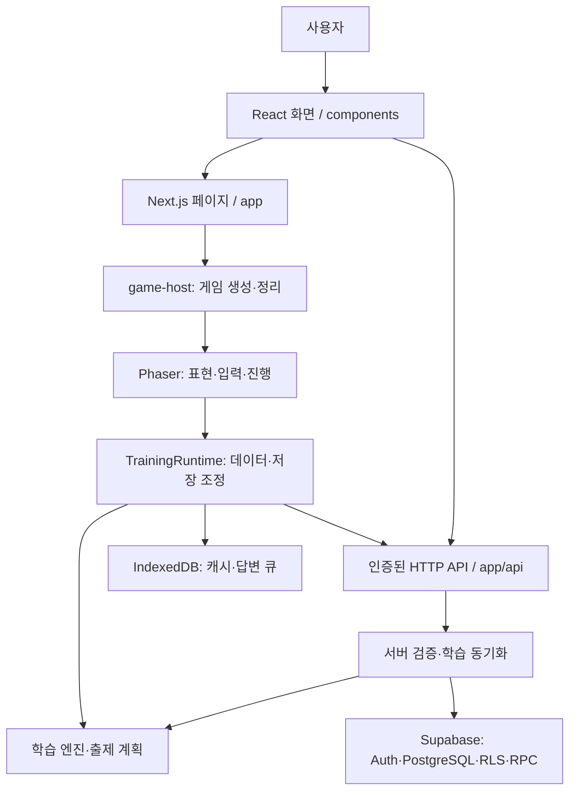
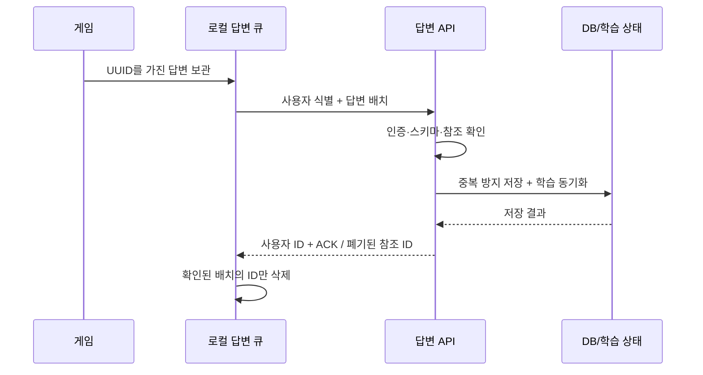

# 프로젝트 지도

## 1. 전체 흐름

Sokudoku는 Next.js 앱 안에 React UI와 Phaser 게임을 함께 둡니다. 학습 규칙은 화면과 분리되어 브라우저와 서버가 공유합니다.

화면에서 DB로 직접 쓰기 로직을 늘리기보다 기존 API 경계를 유지합니다. 학습 엔진에는 React/Phaser를 넣지 않고, 게임 표현에는 DB 쿼리를 넣지 않습니다.

## 2. 화면에서 코드를 찾기

| 주소 | UI 입구 | 핵심 의존성 |
| --- | --- | --- |
| `/` | `components/home/home-screen.tsx` | 출제 범위·문제 종류·모드 선택, 계정/설정 |
| `/game` | `app/game/game-host.tsx` | Phaser 동적 로딩, TrainingRuntime |
| `/personal` | `components/personal/personal-screen.tsx` | `use-personal-words`, WordEditor/WordDialog |
| `/notebook` | `components/notebook/notebook-screen.tsx` | `lib/notebook/query.ts`, WordDetail |
| `/dashboard` | `components/dashboard/dashboard-screen.tsx` | `use-dashboard-data`, 집계 표시, 캐릭터 |
| `/sentence` | `app/sentence/sentence-game.tsx` | `lib/sentence/`의 콘텐츠·후보·규칙 |
| `/auth/*` | 확인/오류 화면과 callback route | `lib/auth/`, `lib/supabase/` |
| `/dev/game`, `/dev/sentence` | 개발용 페이지 | 미리보기/수동 확인; 정식 훈련과 구분 |

단어 훈련의 저장/학습 흐름을 문장 훈련에도 동일하게 적용한다고 가정하지 않습니다. 별도 모듈이며 통합은 향후 설계 과제입니다.

## 3. 훈련을 시작하고 답을 저장하기

1. `GameDataLoader` (`lib/game/data/bootstrap.ts`)가 선택 범위의 단어와 학습 스냅샷을 가져옵니다. 공통 단어는 차분 캐시를 사용하고, 개인 단어는 사용자별 집합으로 관리합니다.
2. `TrainingRuntime`이 미전송 답변을 복구하고 `LearningEngine`과 `TrainingPlanner`를 준비합니다. 읽기 후보 준비는 `ReadingSearch`로 분리됩니다.
3. `scene.ts`가 게임 단계를 조정합니다. `training-input.ts`는 입력과 리스너 정리를 담당하고, 카드·효과·오버레이는 별도 파일이 그립니다.
4. 답변은 `AnswerJournal`/`answer-queue.ts`를 통해 사용자 소유의 IndexedDB 큐에 보관됩니다. 서버는 최대 200개씩 받습니다.
5. `/api/game/answers`가 인증, 소유자, 입력 및 삭제된 개인 단어 참조를 검증합니다. 같은 답변 ID의 재전송은 중복 기록을 만들지 않아야 합니다.
6. `synchronizeLearning`이 새 이벤트를 학습 엔진에 적용하고 revision을 확인해 DB에 반영합니다. 늦게 도착한 답변이나 모델 버전 변경 시 시간순 재구축이 필요할 수 있습니다.
7. 클라이언트는 소유자와 ACK를 확인한 답변만 큐에서 제거합니다. 실패한 큐를 단순히 비우면 안 됩니다.

## 4. API의 책임

| API | 책임 | 관련 코드/DB |
| --- | --- | --- |
| `GET /api/game/bootstrap` | 공통 단어/캐시 시작 데이터 | `bootstrap.ts`, DB RPC |
| `GET /api/game/learning` | 정규 학습 상태 동기화 | `learning/server.ts` |
| `POST /api/game/answers` | 답변 저장·동기화·ACK | `answer-schema.ts`, `answer-references.ts` |
| `GET /api/game/meaning-bank` | 뜻 선택지 후보 | `meaning-bank.ts` |
| `GET/POST /api/personal` | 개인 단어 페이지/생성 | `personal_word_page`, `lib/personal/schema.ts` |
| `PATCH/DELETE /api/personal/[id]` | revision을 확인한 수정/삭제 | `updated_at`, 소유자 RLS |
| `GET /api/notebook` | 최근 오답과 P 등록 상태 | `notebook_page` |
| `POST /api/notebook/personal` | 공통 오답의 개인 단어 복사 | `personal-copy.ts` |
| `GET /api/dashboard` | 시간대에 맞춘 학습 현황 | `learning_dashboard` |

`personal`은 전체 소유 단어를 DB에서 검색·필터·정렬한 뒤 20개씩 반환합니다. `notebook`은 최근 최대 100개를 받은 뒤 브라우저에서 검색·필터·정렬하고 10개씩 보여줍니다. 같은 검색 UI라도 데이터 범위는 다릅니다.

읽기 API는 `readIdentity`의 검증된 claims를 사용합니다. 개인 단어 쓰기와 답변 저장은 현재 `getUser()` 검증을 사용합니다. 모든 개인 데이터 접근은 DB의 RLS도 유지해야 합니다. 읽기 응답은 `private, no-store` 정책을 사용합니다.

## 5. UI·상태·스타일 경계

- `components/{home,personal,notebook,dashboard}`: 기능별 화면과 해당 요청/상태.
- `components/ui`: Modal, StageFilter 등 여러 기능에서 실제로 공유하는 UI.
- `components/settings` + `lib/settings-store.ts`: 저장된 언어·테마·훈련 표시 설정.
- `lib/game/selection.ts`: 메인 단계와 난이도 범위. UI마다 숫자 범위를 다시 하드코딩하지 않습니다.
- `styles/home/`: 홈 전역 CSS. `app/globals.css`의 import 순서는 캐스케이드 의미가 있으며 회귀 테스트가 있습니다.
- 개인 단어장·대시보드 등은 CSS Modules 사용. 한 모듈의 `.empty .primary`처럼 함께 쓰는 클래스는 같은 모듈에 둡니다.
- `personal-styles.ts`/`dashboard-styles.ts`는 모듈별 클래스를 합치는 지도입니다. 전역 클래스처럼 취급하지 않습니다.

## 6. 변경 위치 결정하기

| 하고 싶은 변경 | 먼저 볼 곳 | 함께 확인할 것 |
| --- | --- | --- |
| 출제 확률/복습 정책 | `lib/game/learning/` | 탐색·복습·시험 회귀, 공유 엔진의 서버 결과 |
| 입력/일시정지/화면 복원 | `lib/game/phaser/` | 중복 리스너, 키 누름, 종료 후 비동기 작업 |
| 답변 재전송 | `lib/game/data/` + 답변 API | 계정 전환, ACK, 중복, 삭제 참조 |
| 단계/실전 이름 | `selection.ts`, StageFilter, `lib/personal/filters.ts` | P의 의미와 난이도 10을 혼동하지 않기 |
| 단어 등록 항목 | `lib/personal/schema.ts`, editor, API | 발음/한자음/뜻 구분, DB 타입·마이그레이션 |
| 읽기 성능 | 해당 화면 hook → API → RPC | 요청 수·응답 크기·DB 시간 각각 측정 |

큰 디렉터리 이동보다 이 경계를 유지하며 기능 단위로 변경합니다. 타입 전용 역참조는 `import type`으로 표시합니다. 생성된 `database.types.ts`는 임의로 쪼개지 않습니다.
