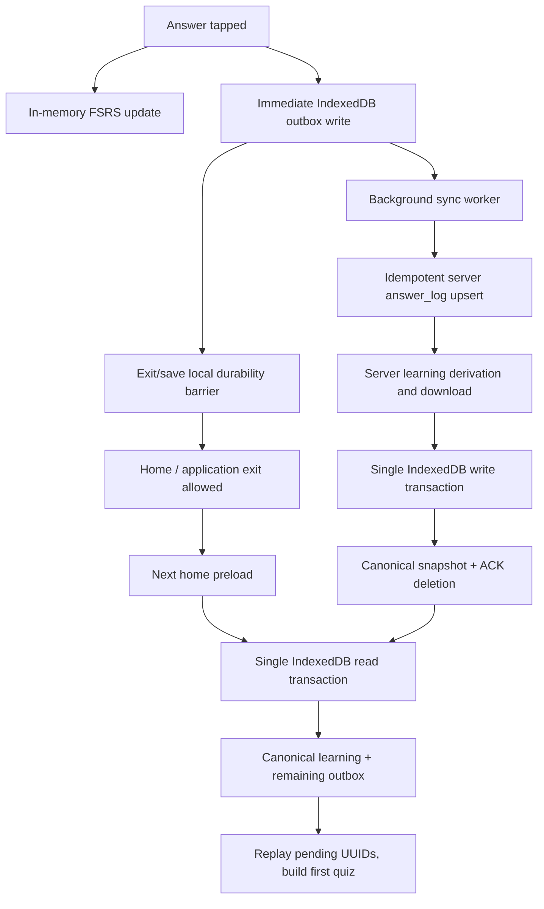

# Local-first training: persistence and crash recovery

## Non-negotiable invariants

1. **One answer, one UUID:** Every tap is assigned a stable answer ID and queued in IndexedDB immediately. Network access is never necessary to record the answer.
2. **Exit means durable locally:** `종료·저장` succeeds only after `AnswerJournal.saveLocal()` confirms all in-memory answers have durable writes. An upload ACK is **not** necessary to leave.
3. **Atomic restart view:** The canonical `SyncSnapshot` and the owner's remaining answer outbox MUST be read in the **same IndexedDB readonly transaction** (`readLocalSync`). Otherwise a worker commit can split the view into an old snapshot and an already-cleared queue.
4. **Server idempotence:** The server deduplicates `answer_log` by answer UUID. Re-uploading after process death must not increment learning evidence twice.
5. **Atomic ACK deletion:** The root worker commits the downloaded canonical cursor/data and deletes only acknowledged local answer UUIDs in **one IndexedDB readwrite transaction**. If it fails, the queue remains replayable.
6. **Outbox is not optional:** IndexedDB errors when recovering pending answers are surfaced, never silently treated as an empty queue.
7. **Identity isolation:** Both the local outbox and the canonical snapshot are filtered by owner; a prewarmed home quiz also carries the selected owner.
8. **Visible question stability:** An in-game sync may replace the undisplayed question queue, but cannot replace the current card. Answers carry their original word source even if the catalog has changed in the meantime.

## Data flow

**Locations:** `AnswerJournal` handles local durability; `SyncEngine` handles push/manifest/pull; `lib/sync/local-store.ts` handles consistent snapshot/outbox reads; `lib/sync/worker.ts` performs atomic server commit; `TrainingRuntime` recovers FSRS and prepares the first question. `GameDataLoader.loadOffline()` uses the same local snapshot when the worker cannot be contacted.

## Failure/restart scenarios

| Failure point | Durable state | Restart behavior |
| --- | --- | --- |
| Before the local IndexedDB write completes | Not guaranteed yet | The answer can be lost if the browser is killed before any durable commit. Never claim a successful exit before the save barrier. |
| Local save succeeds; worker is offline | Answer exists in outbox | Home immediately replays it into FSRS; worker retries later. |
| Server ACK received; process killed before worker commit | Answer exists in outbox and on server | New worker re-sends same UUID, server deduplicates, then downloads and atomically clears outbox. |
| Worker transaction aborts while committing | Previous snapshot and outbox intact | Same retry path, no partial local ACK deletion. |
| Worker commits between home loading steps | Either old snapshot + pending, or new snapshot + cleared pending | Atomic reader prevents the split-brain view. |
| New answer recorded during older upload | New UUID not present in older ACK list | Older commit only removes its own acknowledged UUIDs. |
| Local save overlaps with worker ACK | Already-durable UUID is not re-written by checkpoint | Prevents resurrecting previously acknowledged answers. |
| Account changes or home training selection changes | Owner-specific caches | A different account/selection cannot consume the prior warm runtime. |
| Worker unavailable on offline restart | Canonical sync snapshot already on disk | Fallback reads that same snapshot + outbox atomically instead of stale legacy learning state. |
| Word catalog updated while a question is displayed | Current word still active | Answer retains displayed word source; subsequent questions use new catalog. |

## Verification

`pnpm typecheck` and `pnpm test` are run by `.github/workflows/regression.yml` on the `dev` branch and pull requests to `main`. The crash/re-entry coverage is in `tests/offline-restart.test.ts`; core push/pull idempotence is in `tests/sync.test.ts`; checkpoint and failure handling are in `tests/answer-checkpoint.test.ts`; live catalog transitions are in `tests/catalog-refresh.test.ts`.

These are deterministic automated tests, not a substitute for reproducing Android browser force-kill, OS storage eviction, or real network failure on a physical device. Browser storage can still be lost if the user clears site data, the OS evicts it, or private-mode storage is destroyed before upload. The application must not claim to protect answers that were never durably written.

## Catalog preparation and local I/O

- `prepared.ts` indexes immutable word/distractor dataset maps with WeakMaps. Unchanged dataset identities survive learning-only syncs; word edits, deletions and approval changes replace the relevant maps and invalidate their indexes.
- Build meaning choices only for selected words. Meaning-only responses omit the unused full reading catalog; reading modes still receive unselected common/personal words for distractor search.
- Worker preparation returns a catalog token covering owner, catalog revisions, levels and question kinds. A matching request returns fresh canonical learning and the atomically read pending answers without retransmitting vocabulary. The client holds at most one selected catalog, validates its token/owner and clears it on identity changes. Legacy responses without tokens remain full responses.
- `readLocalSync` queues independent reads in the same readonly transaction. `commitLocalSync` queues independent writes/ACK lookups in one readwrite transaction, preserves unchanged dictionary keys and rejects stale revisions. Errors abort all writes and retain the pending queue.
- Main-thread reading normalization yields after an 8ms slice (checked every 256 rows). Closing a run during a yield cannot start a late worker. Reading index signatures keep the same normalized/sorted JSON representation while initial builds reuse that array instead of parsing it back.
