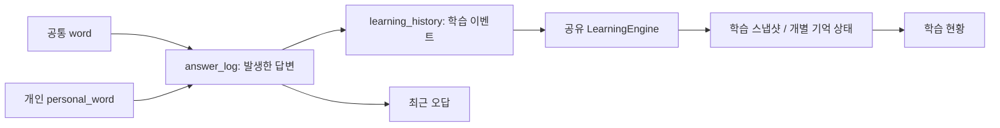

# 데이터와 학습 규칙

이 문서는 현재 코드의 개념 지도입니다. 상세 컬럼/제약은 `lib/supabase/database.types.ts`와 **시간순으로 누적된** `supabase/migrations/`를 확인합니다.

## 단어와 출제 범위

| 개념 | 의미 |
| --- | --- |
| `word` | 공통 카탈로그. 일반 사용자는 읽고, 관리 작업으로 등록/수정 |
| `personal_word` | 사용자 소유 단어. `user_id`로 분리 |
| `entry_type` | 일반 단어(`word`), 히라가나, 가타카나 구분 |
| H / K | 가나 글자 출제 범위. 단어에 가나가 들어 있다는 뜻이 아님 |
| 1~5단계 | 각각 난이도 0~1 / 2~3 / 4~5 / 6~7 / 8~9 |
| P | 메인에서 **내 단어 전체**를 출제하는 범위. 난이도 10만을 의미하지 않음 |
| 실전 | 내 단어장 단계 필터에서 난이도 10을 표시하는 이름 |

공통 단어와 개인 단어는 다른 ID/출처를 갖습니다. 공통 단어를 P에 추가해도 원본을 이동하는 것이 아니라 개인 사본을 만듭니다. P 등록 여부 필터는 원본과 같은 표기/읽기의 개인 단어가 있는지를 나타내므로, 출처 P와 구분해야 합니다.

개인 단어의 중복 기준은 `(user_id, term, kana)`입니다. 같은 표기라도 읽기가 다르면 별도 항목일 수 있습니다. 수정/삭제는 `updated_at`을 보내 다른 탭의 최신 변경을 덮어쓰지 않도록 합니다.

## 한국어 필드 세 가지

| 필드 | 내용 | 예: 実装 / じっそう |
| --- | --- | --- |
| `pronunciation_ko` | 일본어 발음을 한글로 적음 | 짓소우 |
| `hanja_reading` | 한국 한자음 | 실장 |
| `meaning_ko` | 실제 한국어 뜻 | 구현 |

발음과 한자음, 뜻을 서로 대체하지 않습니다. 표시 시 한자음과 뜻은 `실장(구현)`처럼 조합할 수 있습니다. 혼합 표기는 한자를 포함해도 한자음이 NULL일 수 있습니다. 신규 수입/수정 작업은 지정된 로컬 단어 입력 지침도 따릅니다.

## 답변과 학습 상태

- 답변은 문제와 선택지의 **출처+ID**를 구분합니다. 공통 단어 ID와 개인 단어 ID를 동일한 키로 합치지 않습니다.
- 답변 UUID는 클라이언트에서 생성하며 재전송에서도 유지합니다. 서버 ACK 전에 로컬 큐를 삭제하지 않습니다.
- `mode`는 탐색/복습/시험을 구분합니다. 학습 상태는 같은 엔진으로 반영되며 시험이라고 저장을 생략하는 구조가 아닙니다.
- 탐색은 선택된 미학습 단어에서 고르게 고릅니다. 복습 대상과 FSRS 일정은 별도 규칙입니다.
- 서버 학습 동기화는 revision 기반 충돌 감지와 재시도를 합니다. 늦게 도착한 오프라인 기록은 시간순 재구축을 유발할 수 있습니다.
- 개인 단어 삭제는 현재 API의 물리 삭제 경로와 관련 FK 정책을 따릅니다. 연결된 답변/복습 기록도 삭제되므로 확인창이 필요합니다. 초기 논리 삭제 마이그레이션만 보고 현재 동작을 판단하지 않습니다.
- 삭제된 개인 단어를 참조하는 미전송 답변은 서버의 명시적 폐기 ACK로 정리합니다. 임의의 업로드 실패와 구분합니다.

## 캐시와 개인정보 경계

IndexedDB에는 단어 캐시, 사용자별 학습 스냅샷, 미전송 답변이 있습니다. 계정 전환 시 소유자를 확인해야 하며, 인증 오류를 다른 계정의 오프라인 데이터로 우회해서는 안 됩니다.

DB에서는 인증과 RLS를 함께 적용합니다. 공개 가능 키는 service role이 아니며, 서버에서 인증한 사용자도 다른 사용자의 행을 읽거나 변경할 수 없어야 합니다. 클라이언트가 보내는 `user_id`를 권한의 근거로 삼지 않습니다.

## 현재 읽기 모델

- `personal_word_page`: 소유 단어 전체에 검색·단계·정렬 적용 → 개수와 20개 페이지를 같은 조회에서 반환.
- `notebook_page`: 최근 최대 100개 오답에 entry type, P 등록 상태, 수정 시각을 붙여 반환.
- `learning_dashboard`: 요청 시간대에 맞춘 활동/기억/단계 집계.
- `word_recent_stat`: 답변 기반 최근 통계. 학습 스냅샷/FSRS 상태와 같은 개념이 아님.

최신 읽기 최적화의 근거는 `20261113005917_optimize_learning_page_reads.sql`과 `tests/sql/learning_page_reads.sql`입니다. 과거 `personal_word_list`/`game_bootstrap` 설명은 이 현재 API 경로와 구분해 읽습니다.
